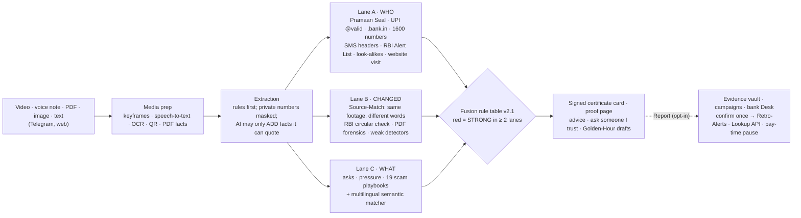

# Pramaan · प्रमाण

**Faces can be faked. Payment rails can't.**

Pramaan is the proof layer for money messages in India. It **proves** what is genuine, **exposes** what was changed, and turns one analyst's confirmation into **protection** for everyone.

- **Prove.** A bank seals its genuine notices and SMS with a Pramaan Seal (Ed25519). Anyone can check a sealed message, and a single edited rupee or an added fee shows up word by word. Senders are also checked against India's official trust rails: SEBI `@valid` UPI, `.bank.in`, 1600-series numbers, DLT SMS headers and the RBI Alert List.
- **Expose.** Many finance deepfakes re-voice real footage. Pramaan finds the genuine original and plays the two side by side: same footage, different words. It also reads what the message asks for: pay, OTP, install, secrecy.
- **Protect.** A user's report goes to a write-once evidence vault and is grouped into a campaign. An analyst confirms it once. From then on every earlier checker gets a Retro-Alert, and a bank app's pay screen can pause before the payment through the Lookup API. Pramaan never blocks a payment.

Team Saksham (TIET, Patiala): Arnav Joshi, Krish Arora · RAKSHAM AI Cybersecurity Hackathon with ARIES, IIT Delhi · Track 03: Deepfake Detection for Financial Communications.

| Try it | |
|---|---|
| Telegram bot | [t.me/PramaanVerifyDemoBot](https://t.me/PramaanVerifyDemoBot) |
| Web check, proof pages, card and seal verification | https://13-207-22-33.sslip.io |
| Lookup a UPI ID, number or link | https://13-207-22-33.sslip.io/lookup |
| Pay-time pause in a bank app (mock) | https://13-207-22-33.sslip.io/demo-bank/pay |
| For banks: integration and API | https://13-207-22-33.sslip.io/partners |
| Pramaan Lab: every number, measured | https://13-207-22-33.sslip.io/lab |
| Red team: attacks we ran against ourselves | https://13-207-22-33.sslip.io/redteam |

Demo data only. Every video shows a team member who gave written consent. Every UPI ID, phone number and "Demo Bank" is fictional or illustrative.

---

## How it decides

Every AI scam has three layers:
- a **Face**: the deepfake;
- a **Claim**: borrowed authority, such as "SEBI-registered", "your bank" or "CBI";
- an **Ask**: pay, share an OTP, install an app.

Detectors fight the Face, an arms race defenders lose. Pramaan checks the Claim and the Ask, and finds the original behind the Face.



- **Matches a known scam pattern** (red): strong evidence from at least **two different lanes**. A detector score alone can never make anything red.
- **Verified sender** (green): the sender checks out against official records or a valid Seal, nothing was changed, and the ask is not high-risk.
- **Can't verify** (amber): everything else. It is the default when unsure. It comes in four kinds, each with its own advice:
  - high-risk ask: don't act;
  - unverified sender: use the official number;
  - nothing to check: how to check yourself;
  - no warning signs (shown in grey): nothing to check and nothing risky, such as "Happy birthday".
- A known scam pattern is never green, even when every link in it is official, and an SMS header typed into the text is context, not proof.
- Pramaan never shows a score, never says "fake" or "fraudster", and never blocks a payment.

The AI model (Groq, with Gemini as fallback) only **reads**:
- It fills a fixed form, and may only add facts it can quote word for word from the message.
- It never sees the verdict, and never decides it.
- OTPs, card numbers, CVVs, Aadhaar, PAN and account numbers are masked before any AI sees the text.
- A separate small model (Prompt Guard 2) flags hidden instructions.

Reasons come from fixed English and Hindi sentences.

## What is built

| Area | What it does | Where |
|---|---|---|
| Channels | Telegram bot: four action buttons, "On a call" mode, family and appeal shortcuts. Web upload and check API. | `app/channels/`, `app/server.py` |
| Extraction | Finds UPI IDs, including disguised, spaced or spoken ones ("profit wealth at the rate YBL"). Also finds phones (with Hindi digits), links, SMS headers, SEBI numbers, accounts, claims, and asks and pressure in English, Hindi and Hinglish. Masks private numbers. Flags hidden AI instructions. | `app/extract/` |
| Lane A · WHO | Checks, in order:<br>• **Pramaan Seal** check<br>• SEBI `@valid` UPI rule<br>• official domains of 24 banks<br>• look-alike domains, including Cyrillic letters and fake `.bank.in` zones<br>• 1600-series rule, DLT headers, RBI Alert List (95)<br>• QR payee vs the claimed institution<br>• DoT FRI (**mock**)<br>• a safe homepage-only visit to any website named in the message: does it exist, its age (RDAP), what it calls itself, what it asks you to type, and a screenshot | `app/lanes/lane_a.py`, `app/lanes/site_check.py`, `app/store/seal.py` |
| Lane B · CHANGED | • Video Source-Match: PDQ fingerprints, time-offset scan, word diff, re-transcription<br>• "official original" recognition<br>• document Source-Match against 25 real RBI circulars<br>• PDF forensics, local OCR with Hindi fallback, UPI QR decoding<br>• one open-source video detector as a **weak** hint only | `app/lanes/`, `app/media/` |
| Lane C · WHAT | High-risk asks and pressure tactics. 19 scam playbooks, each linked to a public advisory. A local multilingual matcher (`multilingual-e5-small`) for rewritten scams. | `app/lanes/lane_c.py`, `app/lanes/semantic.py`, `app/rails/data/` |
| Verdict | Versioned rule table, amber kinds, bilingual reason templates and advice | `app/fusion/`, `app/explain/templates.py` |
| Outputs | Banknote-style certificate card with a signed QR. Proof page with synced side-by-side playback and "How fresh is this?". Verify page. "Ask someone I trust" loop. Golden-Hour Kit with ready-to-paste 1930, NCRP and bank drafts. "Listen" (on-device voice). "This looks wrong" appeals: the analyst's answer goes back to the person, and an upheld verdict is marked "Corrected". | `app/render/`, `app/explain/complaint.py` |
| Issuer side | Issuer console: seal a notice or SMS, download the sealed PDF or PNG, revoke. Public seal page `/s/CODE`. | `app/routes_seal.py` |
| Bank side | Report → write-once evidence vault with hash chain and signed manifests. Campaigns built from shared hard indicators. Analyst Desk: cookie sign-in, analyst and lead roles, appeals, possible account compromise. Retro-Alerts. Lookup API and pay-time pause. | `app/store/`, `/desk`, `app/routes_protect.py` |
| Measurement | Frozen test split and public split, a 5,971-message open dataset, eval script (Wilson intervals, what-people-are-told tiers, ablation, key experiment, latency), robustness and unseen-family studies, Lab board, red-team suite with known misses and live panel, one-command kit | `eval/`, `/lab`, `/redteam` |
| Live Source-Match | Issuer console: register a short official video live (consent required, deleted after 24 h) and make a labelled test edit, so the jury can test Source-Match on their own footage | `app/media/live_ref.py`, `/issuer` |

## Results

All numbers come from `python -m eval.run` (24 Oct 2026, rules v2.2), `python -m eval.open_kit`, `python -m eval.redteam` and the study scripts. They are read from `eval/results/`; none is typed in by hand. To reproduce everything: `python -m eval.kit` ([eval/REPRODUCE.md](eval/REPRODUCE.md)).

Every verdict is also scored by **what the person is told**, so a false alarm on a genuine message counts even when it isn't red:
**Warn** = don't act (red, or amber with a high-risk request) · **Check first** = confirm through an official channel · **Clear** = green, or "No warning signs".

**Frozen test split, 51 items** (built by us from public advisories and consented clips; hash unchanged since freeze):

| Measure | Result | 95% interval | Round 1 target |
|---|---|---|---|
| Genuine items marked red | **0 of 25** | 0–13% | 0 |
| Genuine items warned ("don't act") | **0 of 25** | 0–13% | (none) |
| Genuine items told "check first" | 10 of 25 | 23–59% | (none) |
| Red verdicts that were scams | **11 of 11** | 74–100% | ≥ 95% |
| Scams warned ("don't act" or red) | **24 of 26** | 76–98% | (none) |
| Scams cleared (missed) | **0 of 26** | 0–13% | 0 |
| Scams marked red | 11 of 26 | 26–61% | (none) |

**Public split, 24 items.** Real scam messages and genuine official formats quoted in news reports and advisories, with sources, frozen before the 24 Oct detection changes (`eval/PUBLIC_FROZEN.sha256`).
- **0 of 8** genuine items warned or red; all 8 clear.
- **13 of 16** scams warned, 3 "check first", **0** cleared.
- 1 is red (p14, a fake India Post link); the rest stay amber: the published quotes rarely carry a payment ID or link we can check, so the two-lane rule holds them there.
- Disclosure: four playbooks (23 Oct) were added after this set's first run showed the gap, and the finale-night stress test (`eval/stress_set.yaml`) was written by people who had read this set. The "after" numbers are not fully independent of it.

**Open dataset, 5,971 public SMS** we never trained on (Mishra & Soni 2022, Mendeley Data, CC BY 4.0; `eval/open_kit.py`, rules only). Frozen first run:

| Truth | n | Warned | Check first | Clear | Red |
|---|---|---|---|---|---|
| Legitimate | 4,844 | **1** | 200 | 4,643 | **0** |
| Phishing / fraud | 638 | 4 | 581 | 53 | 0 |
| Unwanted marketing | 489 | 4 | 295 | 190 | 0 |

- False alarms are rare and never red.
- Most phishing is not cleared (585 of 638), but it is rarely escalated to "warn": the set is mostly UK and US prize texts from before UPI, and our rails and playbooks are Indian.
- Its failure list showed that links written as a bare IP address were dropped. We fixed that general gap and re-ran: phishing cleared 53 → 49, legitimate warned unchanged at 1. After the finale-night stress-test rules: legitimate warned 2 of 4,844 (still 0 red), phishing warned 5, cleared 49. The frozen run stays the headline.

**Key experiment (videos, test + dev).**
- On 15 genuine videos (original, WhatsApp-compressed, cropped, trimmed and mirrored, blurry), our open-source detectors alone called **15 of 15** fake. Pramaan marked **0 of 15** red.
- On 7 fakes (4 re-voiced, 3 realistic LatentSync lip-sync), the detectors alone caught 3. Pramaan marked **all 7** red, each with the genuine original shown side by side.

**Ablation.** Removing any one lane cuts scams marked red from 11 to:

| Lane removed | Scams marked red |
|---|---|
| Lane A | 5 |
| Lane B | 9 |
| Lane C | 3 |

No new false reds appear. No single lane decides.

**Robustness** (`python -m eval.robustness`):
- **Rewrites:** 20 frozen test scams were rewritten in Hinglish, formal English, with typos and in Hindi, giving 100 variants.
  - The flagged rate is the same with the semantic matcher on or off.
  - The matcher raises the share that names the right pattern from 80 to 89 of 100 (re-run 24 Oct on rules v2.2).
- **Unseen families:** 41 text scams were re-run with their own playbook removed.
  - 29 were still flagged.
  - None turned green.

**Red team** (`python -m eval.redteam`): **34 of 34** attacks defended, covering prompt injection, disguised payment details, camouflage and borrowed trust, a scam in Tamil, media tricks, forged Pramaan cards, and copied, edited or withdrawn Seals. Three attacks found in our own finale audit beat an earlier version (a typed SMS header plus a real bank link came back green) and are fixed.

**Known misses, shown openly:** a grooming chat that asks for nothing yet; a fake ID shaped like SEBI's `@valid`; a mule account written as an account number. None turns green; each has a named fix on `/redteam`.

The sets are small, so these numbers describe these sets, not the real world. The Lab shows the intervals, and they are wide.

## Run it

```bash
./run.sh            # Linux / macOS
```
```powershell
powershell -File run.ps1   # Windows
```

The first run:
- creates `.venv`;
- installs CPU PyTorch and the requirements;
- installs headless Chromium;
- copies `.env.example` to `.env`;
- starts Pramaan at http://localhost:8000.

With no keys it runs rules-only. Optional keys:
- free Groq or Gemini keys, for the AI extractor;
- a Telegram bot token, for the bot;
- `DESK_TOKEN` / `DESK_LEAD_TOKEN`, to open the analyst Desk (it stays locked otherwise);
- `ISSUER_TOKENS`, for the seal console;
- `PARTNER_KEYS`, for Lookup API partners.

| Command | What |
|---|---|
| `python -m eval.kit` | The whole test kit in one command (tests, both evaluations, red team, robustness) → `eval/results/kit_summary.json` |
| `python -m pytest` | 174 automated tests (~1 min). Tests that need our private clips skip themselves. |
| `python -m eval.run` | Labelled evaluation (~5 min with detectors) → `/lab` |
| `python -m eval.open_kit` | The 5,971-message public dataset, hash-checked (~6 min) → `/lab` |
| `python -m eval.redteam` | Red-team suite (~2 min) → `/redteam` |
| `python -m eval.robustness` | Rewrite and unseen-family studies (~7 min) |
| `python -m tools.prepare_demo --reset` | Back up the database, then pre-check every demo item |
| `python -m tools.build_index` | Rebuild the Source-Match index after adding genuine clips |
| `python -m app.cli "message" --media file` | Developer tool: check from the command line |
| `powershell -File deploy/deploy.ps1 [-CodeOnly]` | Deploy to the demo server (EC2, Caddy HTTPS) |

Not in the repository: our consented clips, test media, model weights (~3 GB, downloaded on first use), keys and the database. Without the clips, Source-Match has nothing to match against, and those tests skip.

## Prototype vs production

| | Prototype (this repo) | Production design (Round 1) |
|---|---|---|
| Hosting | One EC2 `m7i-flex.large` (AWS Free plan), Caddy HTTPS, systemd | API Gateway + WAF + Cognito, Step Functions, Lambda/Fargate, VPC trust zones, ap-south-1 |
| AI extraction | Groq (gpt-oss-120b → 20b → Qwen), then a Gemini fallback, on free tiers with a disk cache. Prompt Guard 2 on Groq. | Amazon Bedrock + Guardrails |
| Scam-pattern matching | Rules + local `multilingual-e5-small` exemplar matcher | Bedrock Knowledge Bases over advisories |
| Speech-to-text | Groq Whisper large-v3 | Amazon Transcribe |
| Fingerprint index | PDQ hashes in a JSON index | OpenSearch |
| Seals | Ed25519 keys on the server, file registry | Keys in AWS KMS per issuer; C2PA for media |
| Evidence vault | Local write-once files, hash chain, Ed25519 signatures | S3 Object Lock (WORM) + KMS |
| Data store | SQLite | DynamoDB |
| Rate limits and roles | In-app limiter (per IP and per chat), cookie roles | WAF rate rules, Cognito groups |
| Channel | Telegram bot. The WhatsApp test account needs business verification. | Bank's verified WhatsApp number and in-app Share |
| Fraud-risk numbers | DoT FRI **mocked** | DoT FRI via the partner bank |

## Responsible AI and limits

See [LIMITS.md](LIMITS.md), [THREAT_MODEL.md](docs/THREAT_MODEL.md) and [DATA_POLICY.md](docs/DATA_POLICY.md). In short:
- No face recognition anywhere.
- No deepfakes of real people; only consented team clips.
- Amber is the default; red needs two independent lanes.
- Humans confirm every campaign, and users can appeal.
- Private numbers are masked before AI.
- Content is wiped after 24 hours unless reported.

Every library, model, dataset, API and AI tool we used is listed in [ACKNOWLEDGEMENTS.md](ACKNOWLEDGEMENTS.md). What was built before and during the event is in [BUILD_LOG.md](BUILD_LOG.md). A plain-language tour of the code is in [docs/CODEBASE_GUIDE.md](docs/CODEBASE_GUIDE.md).
